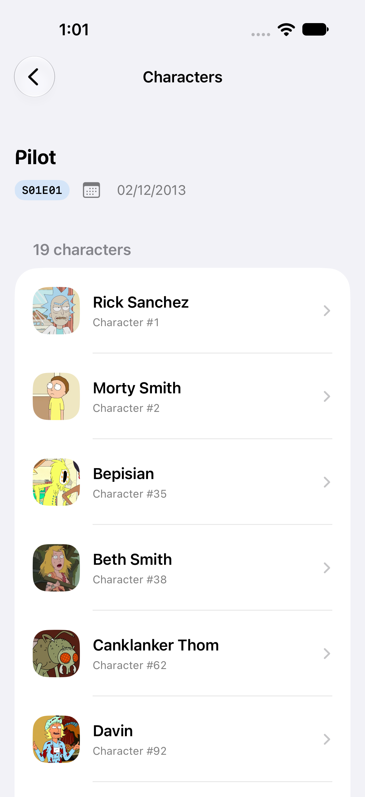
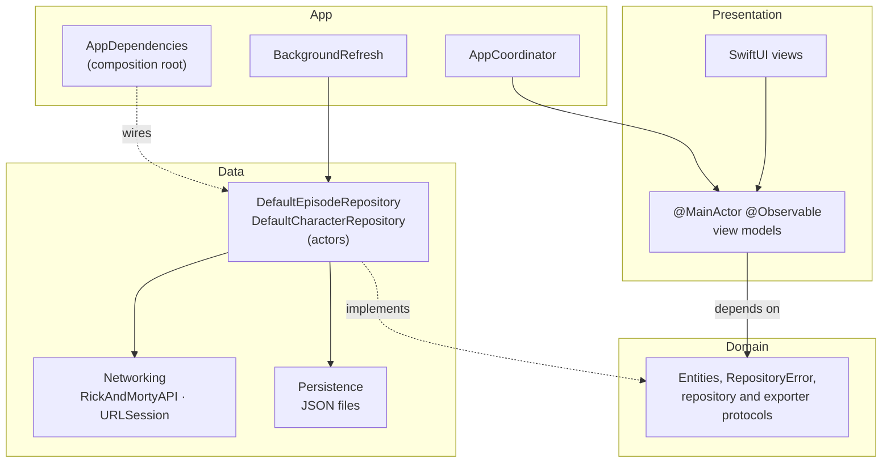

# Rick and Morty Episodes (iOS)

A SwiftUI app that lists every *Rick and Morty* episode from the public
[Rick and Morty API](https://rickandmortyapi.com/documentation), shows each episode's characters, and
exports character details to a file other apps can open.

<p align="center">
  
</p>

[Episode-to-export walkthrough](docs/demo.gif), recorded before the character-list redesign.

| Requirement | Where |
|---|---|
| Episode list (name, air date `dd/mm/yyyy`, code) and "end of list" text | `Presentation/EpisodeList` |
| Episode → names and portraits with tappable character IDs | `Presentation/EpisodeCharacters` |
| Character detail (image, name, status, species, origin, episode count) | `Presentation/CharacterDetail` |
| Export to a local file other apps can open | `Data/Export/CharacterExporter` |
| Background refresh | `App/BackgroundRefresh.swift` |
| *Extra:* persistence, pull-to-refresh, "last updated", unit and UI tests | `Data/Persistence/`, `RickAndMortyEpisodesTests/`, `RickAndMortyEpisodesUITests/` |

## Running

Xcode 26 or later (verified with 27.1), iOS 17 minimum, Swift 6 with complete strict concurrency, no
third-party dependencies. Open `RickAndMortyEpisodes.xcodeproj` and run, or:

```sh
xcodebuild test -project RickAndMortyEpisodes.xcodeproj -scheme RickAndMortyEpisodes \
  -configuration Debug -destination 'platform=iOS Simulator,name=iPhone 17'
```

Tests use Debug-only fixtures, so run them in Debug. Debug builds include saved API responses
(`Resources/StubData`, 51 episodes and 826 characters) served through the real `LiveRickAndMortyAPI`.
UI tests launch with `-uiTesting` and make no network requests (`-resetCache` starts without a cache,
`-networkUnavailable` fails every request).

## Architecture

MVVM with a thin domain layer; dependencies point inward.



Flowcharts for the refresh and caching decisions, and a concurrency map, are in [`docs/design.md`](docs/design.md).

- **Episodes:** `DefaultEpisodeRepository` is the single source of truth, shared by the UI and the
  background task. Each page is saved as it loads. A refresh fetches page 1 only; its total says whether
  the cached pages are still valid (unchanged: keep them, grew: load the new ones on scroll, shrank: keep
  page 1 only).
- **Characters:** details and portraits load as character rows appear and are saved as files, so
  previously viewed characters work offline. IDs remain tappable if a row cannot load its details.
  Saved details are reused for 30 days while the catalogue size is unchanged (or unknown); otherwise they
  are refetched and still served if that fails, except on a 404.
- **Errors:** `APIError` → `RepositoryError` → user wording in `Presentation/Shared/ErrorMessages.swift`.
  Cancellation is never shown as an error.
- **Configuration:** `AppConfiguration` (API URL, 12 h freshness, 30-day character age, timeouts) is
  chosen in the app entry point and passed explicitly; there is no global.
- **Dependency injection** is by initialiser, wired in `AppDependencies`.

## Key decisions

| Decision | Why |
|---|---|
| Refresh page 1 only | One request however many pages exist; fits a background task's time. Episodes are only added at the end |
| JSON files in actors, not SwiftData | About 50 records, always read and written whole |
| Load characters as their rows appear | Names and portraits make the list recognizable without downloading all 826 characters |
| `BGAppRefreshTask` plus a foreground refresh when data is over 12 h old | iOS doesn't guarantee background runs |
| Text export in `Documents/Exports` plus a share sheet | Any app can open it and Files shows it |
| Portraits saved as files, not `AsyncImage` | `AsyncImage` can't save to disk, so an opened character would lose its photo offline |

## Background refresh

- **App in the background:** a `BGAppRefreshTask` saves a fresh page 1, scheduled for no sooner than 12 h
  when the app goes to the background.
- **App open:** the cached list shows at once, and data over 12 h old refreshes quietly at launch and on
  return ("Updating…", no full-screen loader).

To trigger the task on a device, pause in the debugger after backgrounding the app and run:

```
e -l objc -- (void)[[BGTaskScheduler sharedScheduler] _simulateLaunchForTaskWithIdentifier:@"dev.felixinjapan.RickAndMortyEpisodes.refresh"]
```

## Known limitations

- Offline, the list reaches only as far as the user has scrolled; only previously loaded character details and portraits are available.
- No automatic retry or `NWPathMonitor`; the user retries.
- English only; the `dd/MM/yyyy` format is fixed.
- Background refresh hasn't been observed on a physical device; the logic is unit-tested.
- For real health data: stronger file protection, no personal data in logs, certificate pinning.
