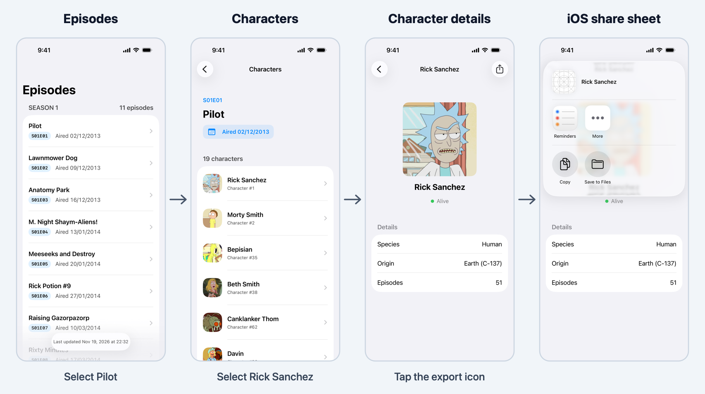

# Rick and Morty Episodes (iOS)

A SwiftUI app for browsing *Rick and Morty* episodes, viewing their characters, and exporting character details as a text file.

## UI map

[](docs/ui-map.png)

## Run and test

Requires Xcode 26 or later and iOS 17 or later. Open `RickAndMortyEpisodes.xcodeproj` and run the `RickAndMortyEpisodes` scheme. Run tests in Debug so the app can use the bundled fixtures.

```sh
xcodebuild test -project RickAndMortyEpisodes.xcodeproj -scheme RickAndMortyEpisodes \
  -configuration Debug -destination 'platform=iOS Simulator,name=iPhone 17'
```

## Features

- Episode list with name, air date (`dd/mm/yyyy`) and code, grouped by season and loaded page by page, with an end-of-list message once every episode is on screen.
- Tap an episode to see its characters by ID, with names and portraits as they load. Tap a character for the image, name, status, species, origin and episode count.
- Export a character's details as a text file. The export button opens the iOS share sheet, and the file is written only when you pick a destination there (Save to Files, AirDrop, Mail, another app).
- Episodes, character details and portraits are saved on disk, so the list opens offline. Pull to refresh, and a "last updated" timestamp.
- Unit tests and UI tests that run on recorded API responses, without the network.

## Background refresh

The app asks iOS for a `BGAppRefreshTask` when it goes to the background. The task refreshes the first episode page. On launch and when the app returns, it shows the cached list immediately and refreshes it without blocking the screen if the data is more than 12 hours old. iOS decides whether and when a scheduled task runs.

## Architecture

MVVM with plain folders: `Presentation` (views and view models), `Domain` (entities and protocols), `Data` (API client, repositories, JSON file stores) and `App` (composition root). Views hold only view models; repositories are reached through protocols. There is no use-case layer and no database, because each screen calls one repository method and the data is small. See the [architecture and decision log](docs/architecture.md) for the dependency map, concurrency model and trade-offs.

## Known limitations

- Offline, the list shows the pages already loaded, and character details and portraits must have been opened before.
- Scheduled background refresh is unit-tested but not verified on a physical device.
- English only, with a fixed `dd/MM/yyyy` air date format.
