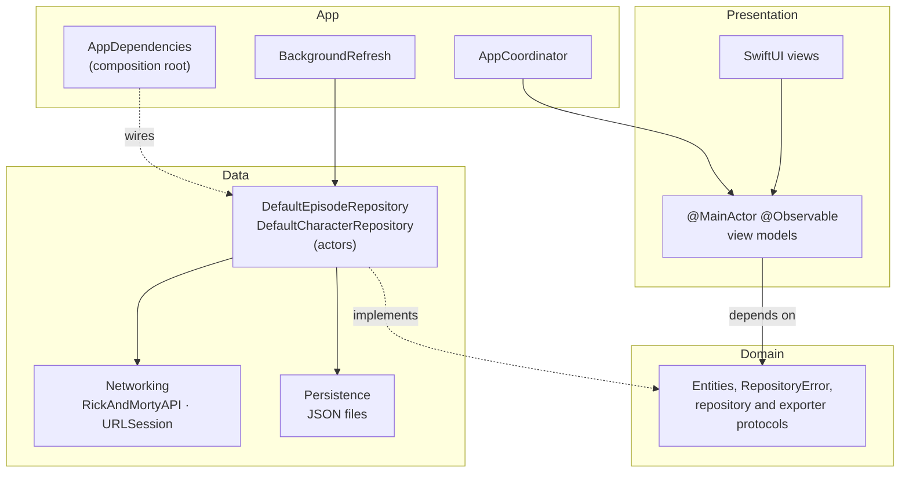
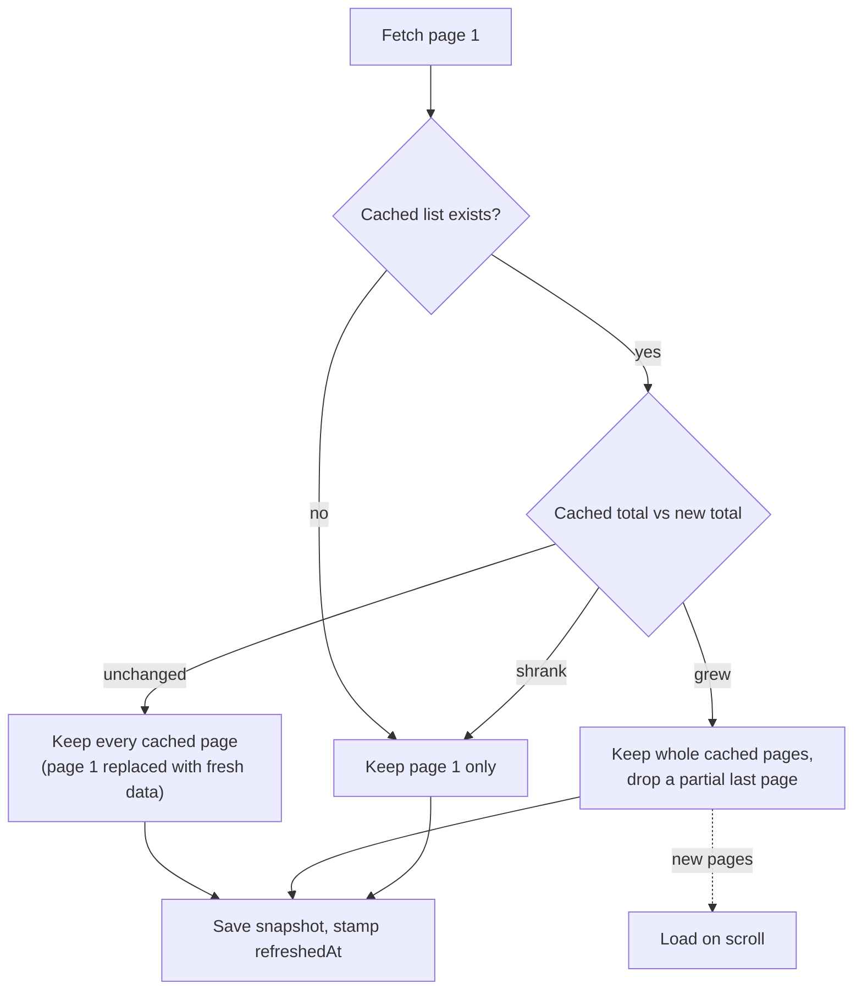
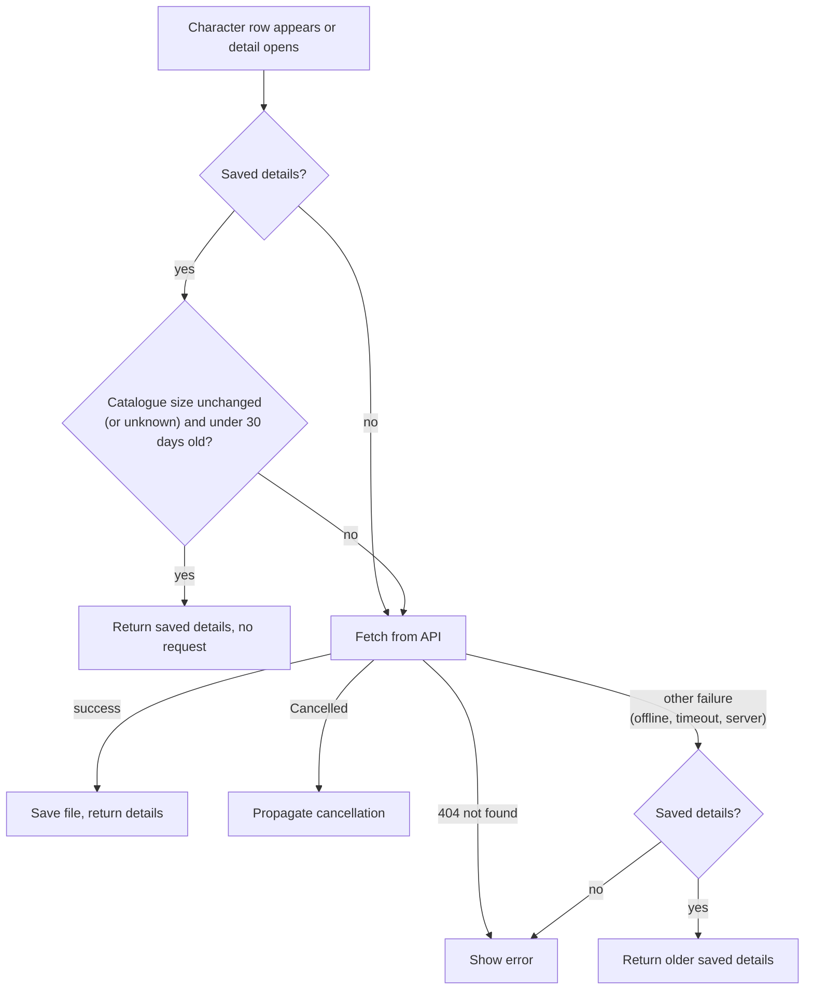
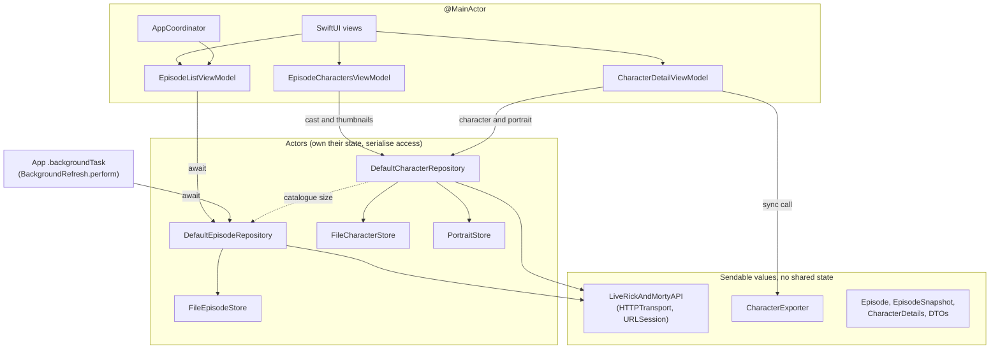

# Architecture and decision log

The app uses MVVM. SwiftUI views and their view models depend on domain types and protocols. `AppDependencies` wires the repositories, stores, and exporter through initializers. The app entry point supplies the API URL, cache intervals, and network timeouts through `AppConfiguration`.



`APIError` is translated to `RepositoryError` in the data layer. `Presentation/Shared/ErrorMessages.swift` maps repository errors to user-facing messages. Cancellation stays silent.

## Decision log

| Decision | Rationale and trade-off |
|---|---|
| Refresh only the first episode page | One request fits the background refresh budget. Cache reuse relies on new episodes being appended. Later pages load as the user scrolls. |
| Persist episodes as a JSON snapshot and character details as individual JSON files | The episode list is small and read as a whole. Per-character files let the app save a character without rewriting the rest of the cache. Actors serialize access to the stores. |
| Batch character details for visible rows after scrolling settles | The first screen loads after layout. Later viewports wait 200 ms so a fling can skip intermediate rows. Portrait requests start for settled rows. |
| Schedule background refresh and check freshness in the foreground | iOS decides whether the background task runs. Checking freshness on launch and return gives the app another chance to refresh while cached episodes stay visible. |
| Export a text file to `Documents/Exports` | Files exposes the saved file and the iOS share sheet hands it to other apps. The app writes the small export synchronously on the main actor. |

## Episode refresh

`DefaultEpisodeRepository.refreshFirstPage()` fetches page 1 only. It uses the episode count to decide which cached pages to keep and assumes new episodes are appended.



## Viewing a character

The character list tracks rows that are at least half visible. It batches their IDs after scrolling
settles and lets any batch already sent finish so its results can be reused. The repository reads
cached details first and requests missing or stale IDs. Rows with unavailable details remain tappable
by ID. The detail screen uses `character(id:)` and shows a Retry button if loading fails.



The repository reuses any readable portrait it has saved, regardless of age. If the file is missing
or unreadable, the repository downloads and saves a replacement.

## Concurrency map

The project uses Swift 6 with complete strict concurrency checking and explicit actor isolation. UI state lives on the main actor. Repository and file-store actors serialize access to their state.



- The UI and the background task share the `DefaultEpisodeRepository` actor. Refresh requests can overlap, and the file store writes snapshots one at a time.
- **Paging starts near the viewport.** The footer starts a request when it comes within 120 points of the visible list. After each append it measures its new position before another page can start. `loadNextPage()` lets a request already sent finish when the footer scrolls away. A generation counter drops results for a list that a refresh has replaced.
- **Refresh errors leave the footer alone.** A failed pull-to-refresh or stale check with rows on screen sets a separate message and the cached list stays usable. A cancelled request shows nothing.

## Background refresh

When the app enters the background, it requests a `BGAppRefreshTask` with an earliest start 12 hours later. The task refreshes the first episode page. On launch and return, the app shows cached episodes immediately and refreshes data older than 12 hours while the list remains visible.

To simulate the task on a device, background the app, pause it in the debugger, and run this command in LLDB.

```
e -l objc -- (void)[[BGTaskScheduler sharedScheduler] _simulateLaunchForTaskWithIdentifier:@"dev.felixinjapan.RickAndMortyEpisodes.refresh"]
```

## Test fixtures

Debug builds include saved responses for 51 episodes and 826 characters under `Resources/StubData`. UI tests launch with `-uiTesting`, which routes requests through the recorded `LiveRickAndMortyAPI` and uses a dedicated cache. `-resetCache` clears that cache, and `-networkUnavailable` simulates failed requests. These tests run without live network access.

Add `-delayedEpisodeFeed` alongside `-uiTesting` to simulate 10,000 episode pages with a one-second delay per page. Page four fails once with HTTP 503 so the footer's Retry behavior can be exercised.

## Known limitations

- Offline, the episode list includes the pages already loaded. Character details and portraits must have been loaded previously.
- Users retry failed requests manually.
- The app uses English and a fixed `dd/MM/yyyy` date format.
- Background refresh logic is unit-tested. Scheduled execution on a physical device remains unverified.
- An implementation that handles real health data would need stronger file protection, logging that excludes personal data, and certificate pinning.

## Feature locations

| Requirement | Where |
|---|---|
| Episode list (name, air date `dd/mm/yyyy`, code) and "end of list" text | `Presentation/EpisodeList` |
| Episode → names and portraits with tappable character IDs | `Presentation/EpisodeCharacters` |
| Character detail (image, name, status, species, origin, episode count) | `Presentation/CharacterDetail` |
| Export to a local file other apps can open | `Data/Export/CharacterExporter` |
| Background refresh | `App/BackgroundRefresh.swift` |
| *Extra:* persistence, pull-to-refresh, "last updated", unit and UI tests | `Data/Persistence/`, `RickAndMortyEpisodesTests/`, `RickAndMortyEpisodesUITests/` |
