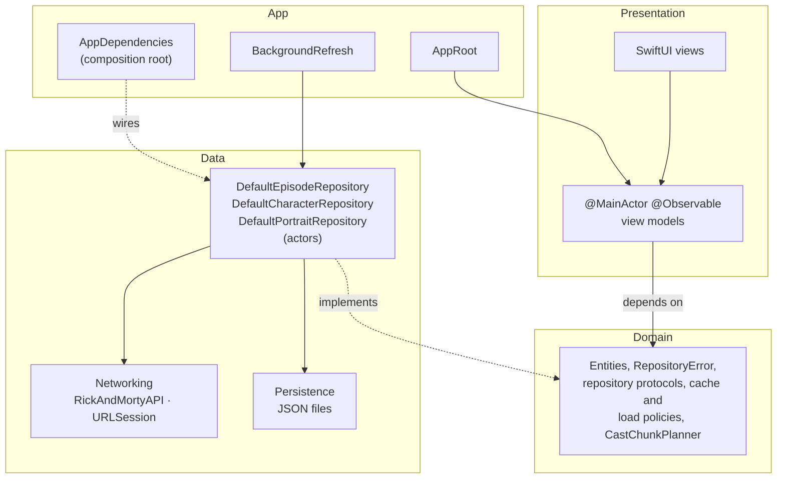
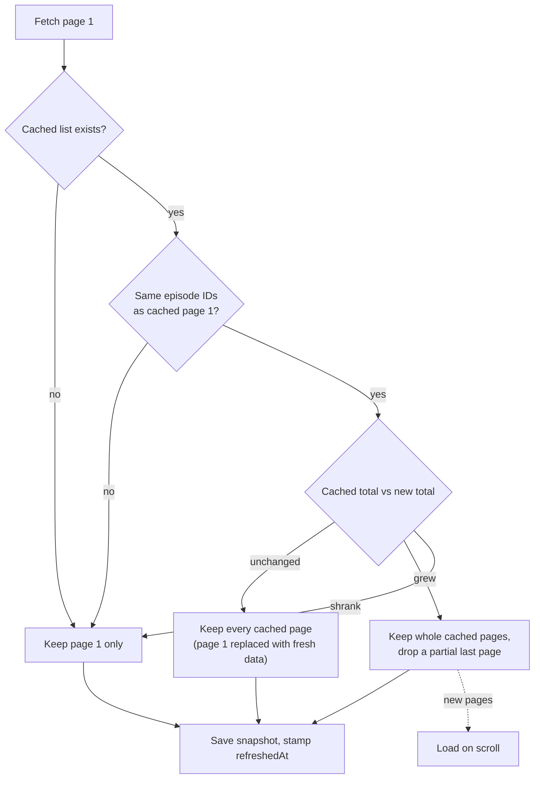
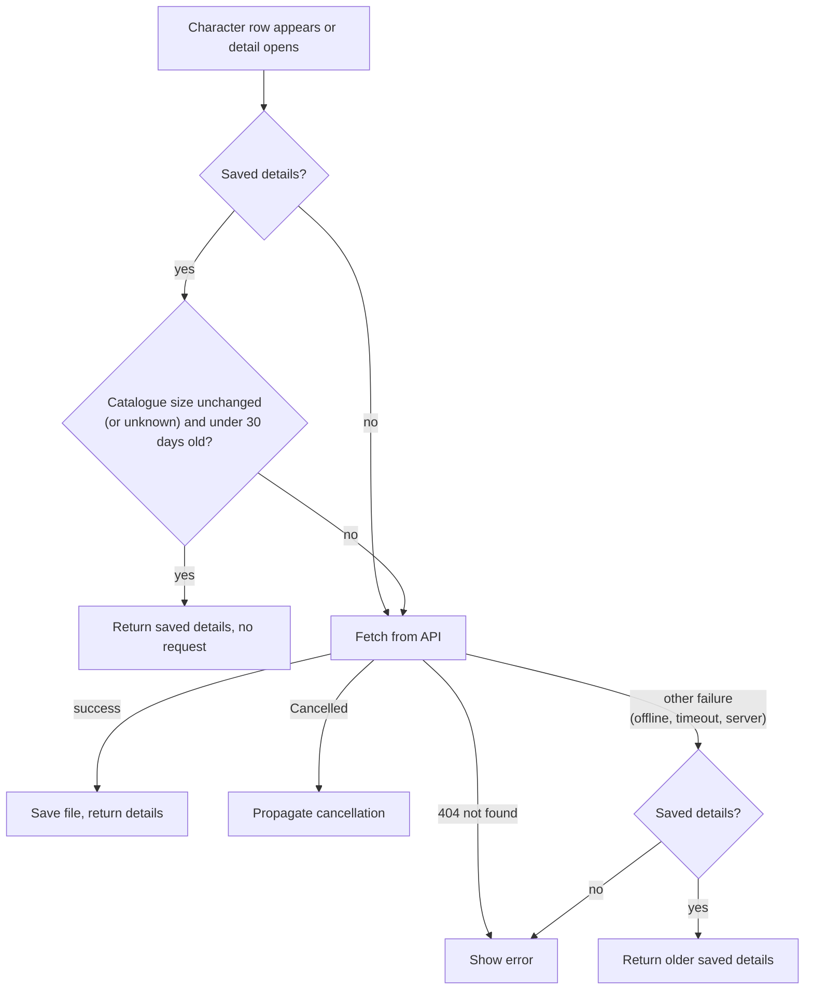
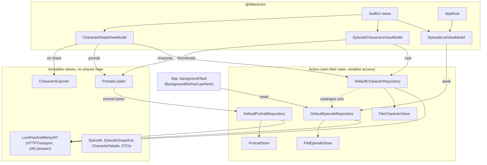

# Architecture and decision log

The app uses MVVM. SwiftUI views and their view models depend on domain types and protocols. `AppDependencies` wires the repositories, stores, and exporter through initializers. The app entry point supplies the API URL, cache intervals, and network timeouts through `AppConfiguration`.



Views take only view models. `CharacterScreens` (built in `AppDependencies`) creates the cast and detail view models, so no view holds a repository or the exporter. `DefaultPortraitRepository` downloads and saves portrait bytes, and `PortraitLoader` in the data layer turns them into display-sized images and retries temporary failures once. The view models receive it, and the exporter, as plain function types (`LoadThumbnail`, `ExportCharacter`), because each has one method and one implementation. The cast view model keeps the results per URL, so a finished portrait redraws only its own row.

Rules that decide when to ask again are small, pure types in `Domain`, so they are tested without a view model or a store: `CharacterCachePolicy` (details expire by age or when the catalogue changes size), `EpisodeRefreshPolicy` (the list is stale after 12 hours), `PortraitLoadPolicy` (which portraits to request, the 30-second retry delay, and how many outcomes to remember) and `CastChunkPlanner` (the 20, then 80 chunking). The repositories and view models call them and keep the side effects.

`APIError` is translated to `RepositoryError` in the data layer. `Presentation/Shared/ErrorMessages.swift` maps repository errors to user-facing messages. Cancellation stays silent.

## Decision log

| Decision | Rationale and trade-off |
|---|---|
| Refresh only the first episode page | One request fits the background refresh budget. Cache reuse relies on new episodes being appended. Later pages load as the user scrolls. |
| Persist episodes as a JSON snapshot and character details as individual JSON files | The episode list is small and read as a whole. Per-character files let the app save a character without rewriting the rest of the cache. Actors serialize access to the stores. |
| Load character details in chunks: 20, then 80, then 80 at a time | The first request is small so the first screen fills quickly, and the next 80 follow at once. Later chunks start when a visible row is 80% through the loaded chunk. A request holds at most 80 IDs, so the URL and response stay small for any cast, and a short cast needs one or two requests. A jump loads the chunk around its destination, not the chunks in between. Later viewports wait 200 ms so a fling can skip rows. Portraits stay lazy: only rows near the viewport start a download. |
| Schedule background refresh and check freshness in the foreground | iOS decides whether the background task runs. Checking freshness on launch and return gives the app another chance to refresh while cached episodes stay visible. |
| No use-case layer, no SwiftData | Each screen calls one repository method, so a use case would only forward the call. Episodes and characters are small and read whole or by ID, so JSON files behind actor stores cover offline use without a database schema or migrations. Revisit both if a screen needs to combine several repositories or query the cache. |
| Export through the share sheet, writing the file only when a destination is picked | The export button is a `ShareLink`, so it behaves like the share control users expect and saves nothing by itself. `CharacterExportFile` is `Transferable` and writes the small text file to the temporary folder when the user chooses Save to Files, AirDrop or another app. |

## Episode refresh

`DefaultEpisodeRepository.refreshFirstPage()` fetches page 1 only. It compares page 1's episode IDs and the episode count with the cache to decide which cached pages to keep, and assumes new episodes are appended. Different IDs on page 1 mean the later pages have shifted, so they are dropped even when the count is the same.



## Viewing a character

The character list tracks rows that are at least half visible. After scrolling settles, it requests
the chunk of the cast that holds them (the first 20 rows, then 80 per chunk), then the portraits of the
visible rows, then the next chunk once a row is 80% through its chunk, so a prefetch never delays what is
on screen. `CastChunkPlanner` holds the chunk sizes and the 80% rule as plain values, so the view model only sequences the loads. It lets any batch already sent finish so its results can be reused. The repository reads
cached details first and requests missing or stale IDs. Rows with unavailable details remain tappable
by ID. The detail screen uses `character(id:)` and shows a Retry button if loading fails.



`DefaultPortraitRepository`, separate from the character repository, reuses any readable portrait it has
saved, regardless of age. If the file is missing or unreadable, it downloads and saves a replacement.
Callers asking for the same portrait at once share one download.

## Concurrency map

The project uses Swift 6 with complete strict concurrency checking and explicit actor isolation. UI state lives on the main actor. Repository and file-store actors serialize access to their state.



- The UI and the background task share the `DefaultEpisodeRepository` actor. Refresh requests can overlap, and the file store writes snapshots one at a time.
- **Paging starts near the viewport.** The footer starts a request when it comes within 120 points of the visible list. After each append it measures its new position before another page can start. `loadNextPage()` lets a request already sent finish when the footer scrolls away. A generation counter drops results for a list that a refresh has replaced.
- **Refresh errors leave the footer alone.** A failed pull-to-refresh or stale check with rows on screen sets a separate message and the cached list stays usable. A cancelled request shows nothing.

## Background refresh

When the app enters the background, it requests a `BGAppRefreshTask` with an earliest start 12 hours later. The task refreshes the first episode page. On launch and return, the app shows cached episodes immediately and refreshes data older than 12 hours while the list remains visible.

To simulate the task on a device, background the app, pause it in the debugger, and run this command in LLDB.

```
e -l objc -- (void)[[BGTaskScheduler sharedScheduler] _simulateLaunchForTaskWithIdentifier:@"dev.felixinjapan.RickAndMortyEpisodes.refresh"]
```

## Test fixtures

Debug builds include saved responses for 51 episodes and 826 characters under `Resources/StubData`. Archives leave them out (`DEVELOPMENT_ASSET_PATHS`); a plain Release build still copies them, but nothing reads them outside `#if DEBUG`. UI tests launch with `-uiTesting`, which routes requests through the recorded `LiveRickAndMortyAPI` and uses a dedicated cache. `-resetCache` clears that cache, and `-networkUnavailable` simulates failed requests. These tests run without live network access.

Add `-delayedEpisodeFeed` alongside `-uiTesting` to simulate 10,000 episode pages with a one-second delay per page. Page four fails once with HTTP 503 so the footer's Retry behavior can be exercised. Two more flags change the casts in that feed: `-endlessCharacters` gives episode 1 a cast of 10,000 generated characters, and `-characterEdgeCases` does the same and adds an empty cast (episode 2), a missing character, a corrupt portrait, a long mixed-script name, a duplicate and invalid IDs (episode 3), and a character batch that fails once (episode 4).

`-emptyCatalogue` serves a catalogue with no episodes, so the empty state can be tested.

## Known limitations

- Offline, the episode list includes the pages already loaded. Character details and portraits must have been loaded previously.
- A refresh fetches only page 1, so an edit or removal on a later page isn't seen while page 1 and the total stay the same. "Last updated" is when page 1 was last fetched.
- Users retry failed requests manually.
- The app uses English and a fixed `dd/MM/yyyy` date format.
- Background refresh logic is unit-tested. Scheduled execution on a physical device remains unverified.
- An implementation that handles real health data would need stronger file protection, logging that excludes personal data, and certificate pinning.

## Feature locations

| Requirement | Where |
|---|---|
| Episode list (name, air date `dd/mm/yyyy`, code) and "end of list" text | `Presentation/EpisodeList` |
| Episode → names and portraits with tappable character IDs | `Presentation/EpisodeCharacters` |
| Character detail (image, name, status, species, origin, episode count) | `Presentation/CharacterDetail` |
| Export to a local file other apps can open | `Data/Export/CharacterExporter` |
| Background refresh | `App/BackgroundRefresh.swift` |
| *Extra:* persistence, pull-to-refresh, "last updated", unit and UI tests | `Data/Persistence/`, `RickAndMortyEpisodesTests/`, `RickAndMortyEpisodesUITests/` |
