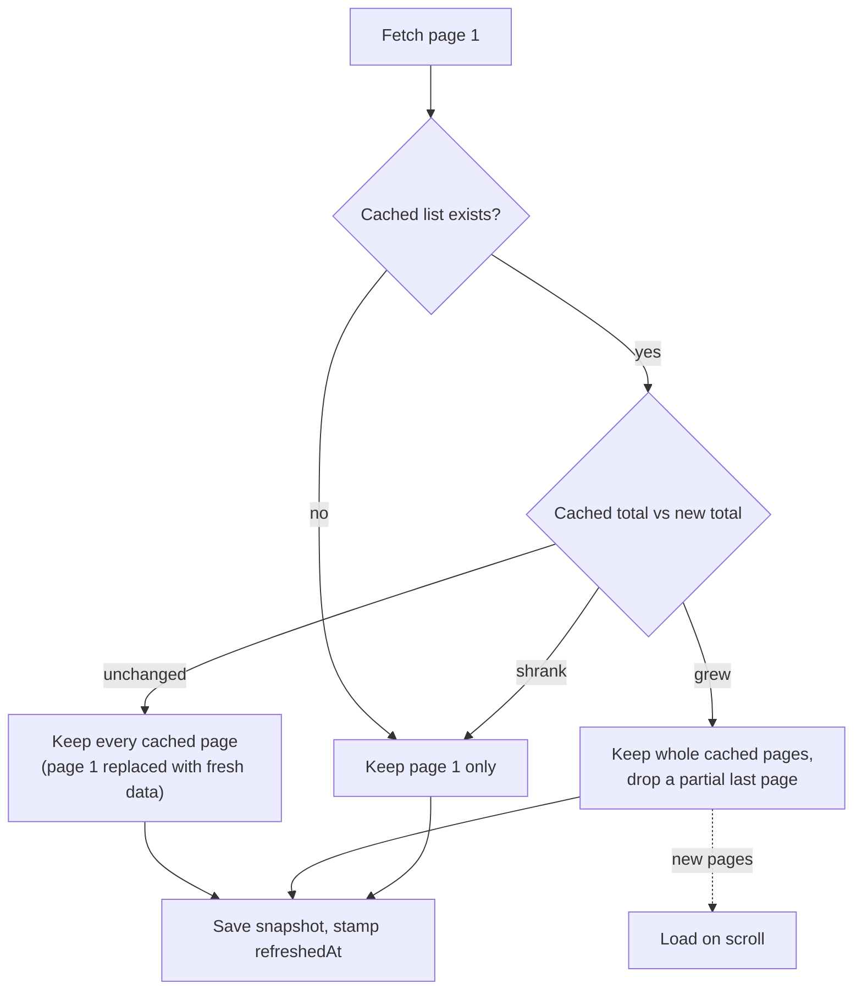
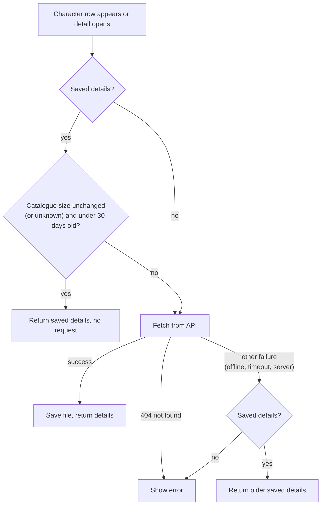
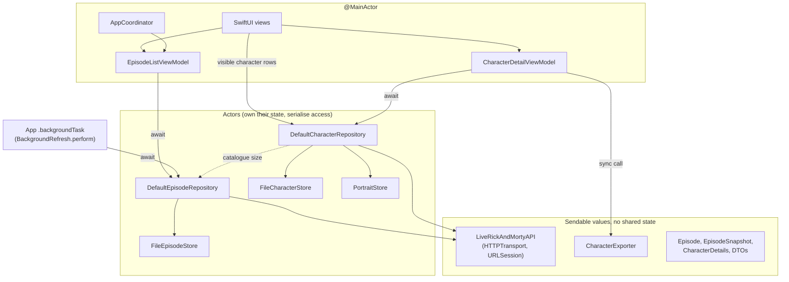

# Design notes

Three decisions that the folder layout doesn't show. The layer overview is in the [README](../README.md#architecture).

## Episode refresh

`DefaultEpisodeRepository.refreshFirstPage()` fetches page 1 only. Its total says whether the cached pages are still valid, because episodes are only ever added at the end.

## Viewing a character

`DefaultCharacterRepository.character(id:)` is used by visible character rows and the detail screen.
Each viewed character is its own file, so saving one rewrites nothing else. A row keeps its tappable
ID if enrichment fails; a missing character on the detail screen shows the existing error and Retry action.

The portrait follows a simpler rule: a saved image that decodes is reused with no age limit (the avatar URL names the character); a missing or unreadable file is downloaded again and replaces the old one.

## Concurrency map

The project builds in Swift 6 language mode with complete strict concurrency checking and no default actor isolation, so every isolation below is declared in code. UI state lives on the main actor; the repositories and file stores are actors, so network and file work runs off the main thread.

- **One owner for the list.** `DefaultEpisodeRepository` is called by both the UI and the background task, so it is an actor: the two can overlap without a data race. Overlapping refreshes aren't merged; each saves a valid list and the store writes one at a time.
- **Paging outlives the view.** `EpisodeListViewModel.loadNextPage()` runs the request in its own `Task`, so scrolling the footer away (which cancels the view's `.task`) doesn't cancel it. A generation counter drops a page that was requested against a list a refresh has since replaced.
- **Refresh errors leave the footer alone.** A failed pull-to-refresh or stale check with rows on screen sets a separate message and the cached list stays usable. A cancelled request shows nothing.
- **One known trade-off.** The exporter's small synchronous file write runs on the main actor. No hitch was measured; a large export would need to move off it.
